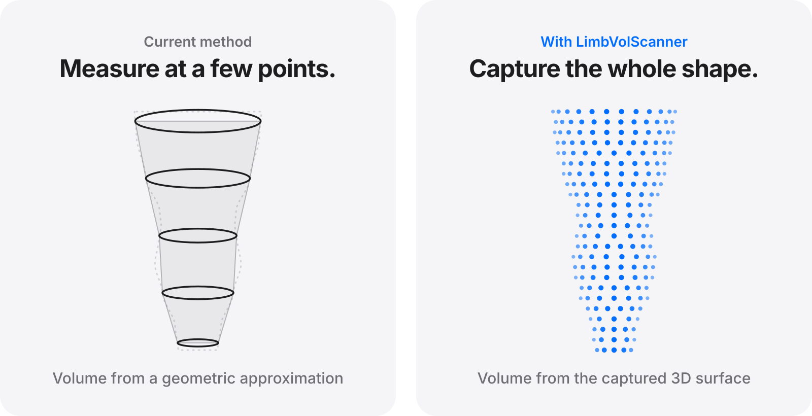
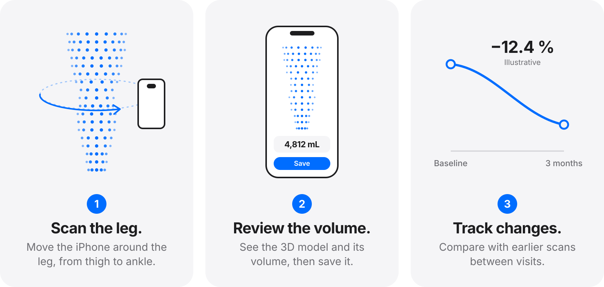

  <a href="https://limbvol.de">
    <picture>
      <source media="(prefers-color-scheme: dark)" srcset="assets/hero-dark.svg">
      
    </picture>
  </a>

  <a href="https://limbvol.de">Website</a>&nbsp;&nbsp;·&nbsp;&nbsp;<a href="#how-it-works">How it works</a>&nbsp;&nbsp;·&nbsp;&nbsp;<a href="#validation">Validation</a>&nbsp;&nbsp;·&nbsp;&nbsp;<a href="#pilot-program">Pilot program</a>

  <b>Development prototype.</b> Not CE-marked; not available for clinical use.

 

<h2 align="center" id="why-3d">Measure the shape itself.</h2>

  Tape measurements at a few points estimate volume with simplified geometry. 
  LimbVolScanner captures the leg’s surface in 3D and calculates volume from that shape.

  <picture>
    <source media="(prefers-color-scheme: dark)" srcset="assets/why-3d-dark.svg">
    
  </picture>

Capturing the whole surface does not, by itself, show greater accuracy. Validation still has to show that.

 

<h2 align="center" id="how-it-works">Scan. Review. Track.</h2>

  A guided scan from the upper thigh to the ankle creates a 3D model and calculates the leg’s volume.

  <picture>
    <source media="(prefers-color-scheme: dark)" srcset="assets/how-it-works-dark.svg">
    
  </picture>

Illustrative screens and values. Not clinical results.

 

<h2 align="center" id="evaluation">Track volume over time.</h2>

  We want to find out how 3D measurements could help track limb-volume changes in:

  <b>Lymphedema</b>&nbsp;&nbsp;·&nbsp;&nbsp;<b>Lipedema</b>&nbsp;&nbsp;·&nbsp;&nbsp;<b>Pre- and post-treatment measurements</b>&nbsp;&nbsp;·&nbsp;&nbsp;<b>Long-term volume monitoring</b>

 

<h2 align="center" id="validation">Performance validation is pending.</h2>

  Accuracy and repeatability have to be established before any clinical use.

  <picture>
    <source media="(prefers-color-scheme: dark)" srcset="assets/validation-dark.svg">
    
  </picture>

  Open questions: volume error against a reference method, repeatability across repeated scans, 
  the effect of different operators and capture conditions, and a consistent definition of the measured leg segment. 
  Supported iPhone models and a validated capture protocol are not specified yet.

  <a href="https://limbvol.de/measurement.html">Read about the measurement approach&nbsp;›</a>

 

<h2 align="center" id="pilot-program">Interested in testing LimbVolScanner?</h2>

  Clinics and researchers can get in touch to discuss a structured evaluation. 
  An inquiry does not enroll anyone in a study or authorize patient use. 
  Any evaluation requires a separate agreement and the applicable regulatory and data-protection arrangements.

  

  or write to <a href="mailto:kontakt@limbvol.de">kontakt@limbvol.de</a>

  <b>Please do not include patient information or health data.</b>

 
 

  <a href="https://limbvol.de">
    <picture>
      <source media="(prefers-color-scheme: dark)" srcset="assets/limbvol-logo-dark.svg">
      
    </picture>
  </a>

<b>3D measurement. Real impact.</b>

  <a href="https://limbvol.de/contact.html">Contact</a>&nbsp;&nbsp;·&nbsp;&nbsp;<a href="https://limbvol.de/privacy.html">Privacy</a>&nbsp;&nbsp;·&nbsp;&nbsp;<a href="https://limbvol.de/impressum.html">Impressum</a>&nbsp;&nbsp;·&nbsp;&nbsp;<a href="https://limbvol.de/datenschutz.html">Datenschutz</a>

  © 2026 LimbVolScanner. All rights reserved. No license is granted to use, copy, modify, or distribute the contents of this repository.

